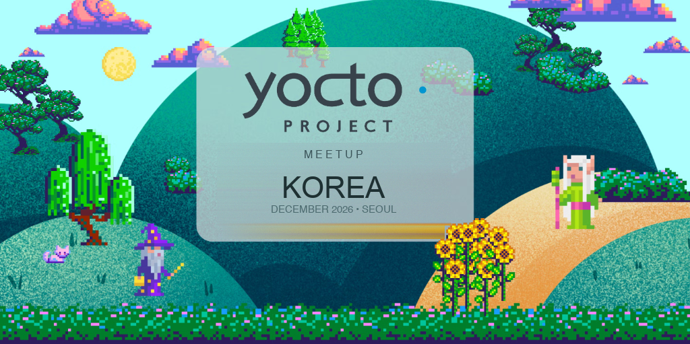

# Yocto Project Meetup Korea 2026

한국 임베디드 리눅스 및 Yocto Project 엔지니어들을 위한 기술 교류 및 네트워킹 밋업 공식 GitHub 페이지입니다.

🌐 **공식 웹사이트**: [https://meetup.yocto.co.kr](https://meetup.yocto.co.kr)

---

## 📌 행사 개요 (Overview)

> **상태**: 🚧 **준비 중 (WIP)** - 장소 확정 (OpenUP), 세부 일정 조율 중

- **일시 (Date)**: 2026년 12월 5일 (토) 13:00 ~ 17:00 / Saturday, December 5, 2026, 13:00 - 17:00 *(잠정 예정)*
- **장소 (Venue)**: [OpenUP (오픈UP 소프트웨어센터, 서울)](https://www.oss.kr/pages/5) *(확정)*
- **규모 (Scale)**: 오프라인 약 50명
- **참가 신청 (Registration)**: 11월 2일(월) 오픈 (신청 내용 검토 후 11월 22일 확정 메일 발송 / 참가비 무료)

---

## 🎙️ 세션 및 타임테이블 (Schedule)

각 발표 세션은 **20분 발표 + 10분 질의응답(Q&A)** 으로 진행되며, 세션 간 휴식 및 발표 종료 후 **자유로운 오픈 네트워킹**이 진행됩니다.

| 시간 (Time) | 발표자 / 구분 (Speaker / Event) | 주제 및 내용 (Topic & Details) |
| :--- | :--- | :--- |
| **13:00 ~ 13:30** | **참가자 등록** &middot; 입장 및 명찰 수령 | 참석자 확인 및 행사 안내 |
| **13:30 ~ 14:00** | **배창혁** (Changhyeok Bae) &middot; Mercedes-Benz Innovation Lab | [Yocto Project Dev Day](https://pretalx.com/ypdd-2026/schedule/) / [ELCE 2026](https://osselceu2026.sched.com/) 후기 |
| **14:00 ~ 14:30** | **손현수** (Hyunsu Son) &middot; LG전자 (LG Electronics) | yocto 메타 클린코드 & 디버깅 |
| **14:30 ~ 14:50** | **네트워킹 및 휴식** (Break & Mixer) | 중간 휴식 및 자유 교류 (20분) |
| **14:50 ~ 15:20** | **양동현** (Donghyun Yang) &middot; LG전자 (LG Electronics) | clang,gcc pgo를 사용하여 최적화 및 빌드속도 향상 |
| **15:20 ~ 15:50** | **모우진** (Woojin Moh) &middot; 텔레칩스 (Telechips) | `TBD` |
| **15:50 ~ 17:00** | **오픈 네트워킹 & 교류** (Social Mixer) &middot; 참석자 전체 | 다과 및 자유 기술 네트워킹 (70분) |

> 💡 발표 세션은 4개 이상으로 확대될 수 있으며, 세부 발표 주제 및 순서는 순차적으로 업데이트됩니다.

---

## 🤝 스폰서십 & 파트너 (Sponsorship)

Yocto Project Meetup Korea의 원활한 운영 및 커뮤니티 활성화를 위해 기업/기관 스폰서 및 파트너를 모집하고 있습니다.
- **커뮤니티 / 프로젝트**: [Yocto Project](https://www.yoctoproject.org/)
- **장소 파트너**: [OpenUP (오픈소스 소프트웨어 통합지원센터)](https://www.oss.kr/pages/5) *(장소 제공/확정)*
